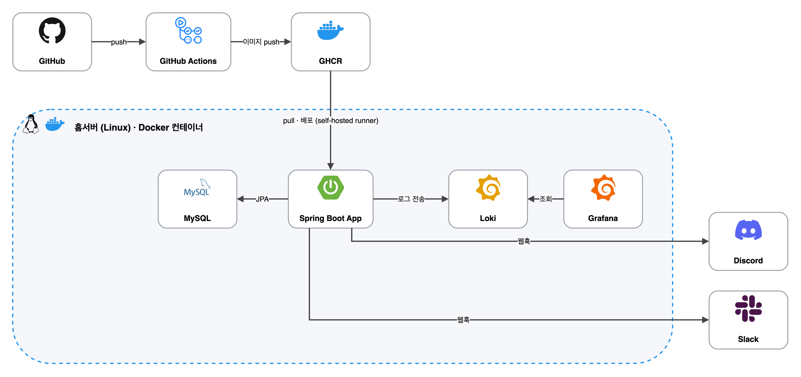
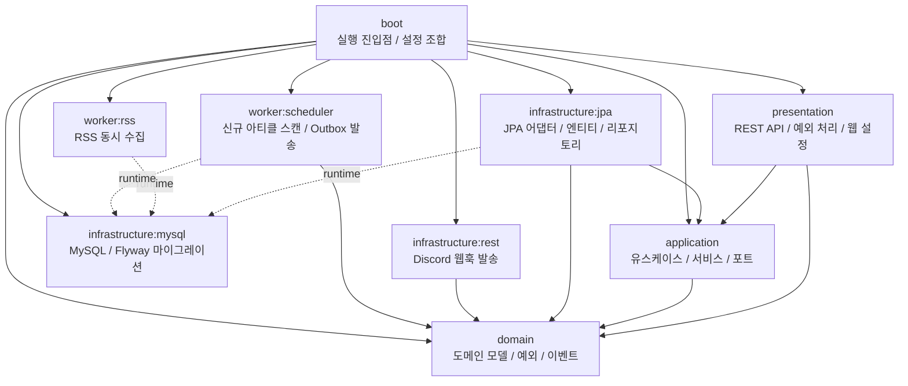

# TechMoa

TechMoa App은 여러 기술 블로그의 RSS를 수집해 아티클을 통합 제공하고, 신규 글 발생 시 웹훅으로 알림을 전달하는 Kotlin + Spring Boot 기반 멀티모듈 백엔드 애플리케이션입니다.

## 핵심 기능

- 여러 기술 블로그 RSS를 가상 스레드로 동시에 수집하고 중복 없이 아티클을 저장합니다.
- 현재까지 약 1,000개의 블로그 아티클을 볼 수 있습니다.
- 웹훅(Discord 등)을 등록하면 이후 수집된 새 글을 MySQL Outbox를 거쳐 직접 발송합니다. 개별·전역 429 제한이 풀리면 발송을 재개합니다.
- Loki + Grafana로 RSS 수집 결과와 알림 발송 성공 건수를 모니터링합니다.

## 알림 예시

새 글이 등록되면 아래처럼 Discord 채널로 알림이 전달됩니다. 약 1,600건 이상의 알림을 보냈습니다(2026. 11. 23 기준).

## 인프라 구조

홈서버(Linux)에 Docker 컨테이너로 배포합니다. GitHub Actions가 이미지를 GHCR에 올리면 self-hosted runner가 받아 배포하고, 앱 로그는 Loki로 수집해 Grafana로 시각화합니다. 새 글 알림은 Discord, Slack 등 여러 메신저를 한 그룹으로 묶은 웹훅 플랫폼으로 전송하며, 새 메신저는 같은 방식으로 추가할 수 있습니다.

## 멀티모듈 구조

## 모니터링

Loki로 수집한 로그와 앱 지표를 Grafana 대시보드로 확인합니다.

**RSS 수집**

- **전체 RSS 평균 수집 시간:** 선택한 기간의 모든 RSS 수집 시도(성공과 실패 포함)를 합산한 평균 시간(ms)입니다. 수집이 전반적으로 느려졌는지 한눈에 봅니다.
- **선택 기간에 실패한 블로그 · 실패 횟수:** 조회 기간 동안 수집에 실패한 블로그와 블로그별 실패 횟수입니다. 이후 회복된 블로그도 기간 내 실패가 있으면 표시됩니다.
- **피드별 마지막 수집 성공 · 최근 7일:** 블로그별로 마지막 수집 성공 시점입니다. 최근 7일간 성공 기록이 있는 피드만 보여 주며, 오래된 성공부터 정렬해 한동안 멈춘 피드를 먼저 찾을 수 있습니다.
- **피드별 평균 수집 시간 · 성공 및 실패 시도 포함:** 블로그별로 HTTP 요청부터 피드 파싱까지 걸린 평균 시간(ms)입니다. 실패한 시도도 포함하며 DB 저장 시간은 제외합니다.
- **수집 회차별 전체 · 성공 · 실패:** 수집 회차마다 대상 피드 수(total)와 성공·실패 피드 수를 시간순으로 보여 주는 로그입니다.

**알림 발송**

- **최근 24시간 발송 성공 건수:** 조회 종료 시각 직전 24시간 동안 발송에 성공한 요청 수입니다. 같은 글을 웹훅 3개에 보내면 3건으로 셉니다. 해당 로그가 없으면 0이 아니라 "데이터 없음"으로 표시합니다.
- **발송 가능한 알림의 최장 대기 시간:** Outbox에서 아직 보내지 않았고 지금 바로 발송할 수 있는 알림 중 가장 오래 기다린 시간(ms)입니다. 대기 시간은 알림 생성 시각과 웹훅·플랫폼별 재시도 시각 중 가장 늦은 시각부터 계산하며, 429 제한으로 쉬는 알림은 제외합니다. 발송할 알림이 없으면 0ms이고, 값이 커지면 발송이 밀리고 있다는 신호입니다.

**Spring · JVM**

- **Spring 프로세스 CPU 사용률:** 앱 프로세스가 사용하는 CPU 비율의 추이입니다.
- **JVM 메모리 사용량:** heap과 nonheap 영역별 메모리 사용량의 추이입니다.

**DB 커넥션 풀 · HikariCP**

- **HikariCP 커넥션과 대기 요청:** 활성·유휴 커넥션 수, 최대 풀 크기, 커넥션을 기다리는 요청 수의 추이입니다. 대기 요청이 늘면 풀이 부족하다는 뜻입니다.
- **HikariCP 평균 커넥션 획득 시간 · 5분:** 최근 5분 동안 커넥션을 얻는 데 걸린 평균 시간입니다. 길어지면 DB나 풀이 병목이라는 신호입니다.
