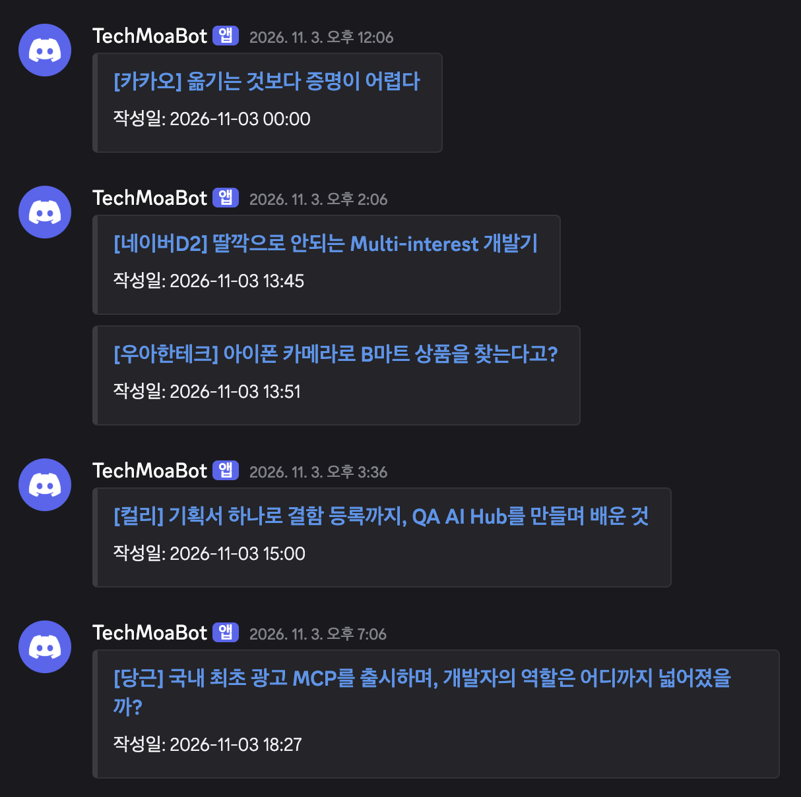
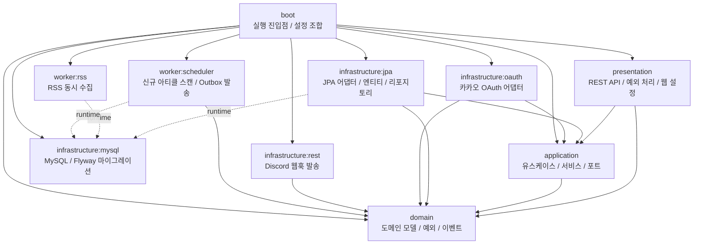
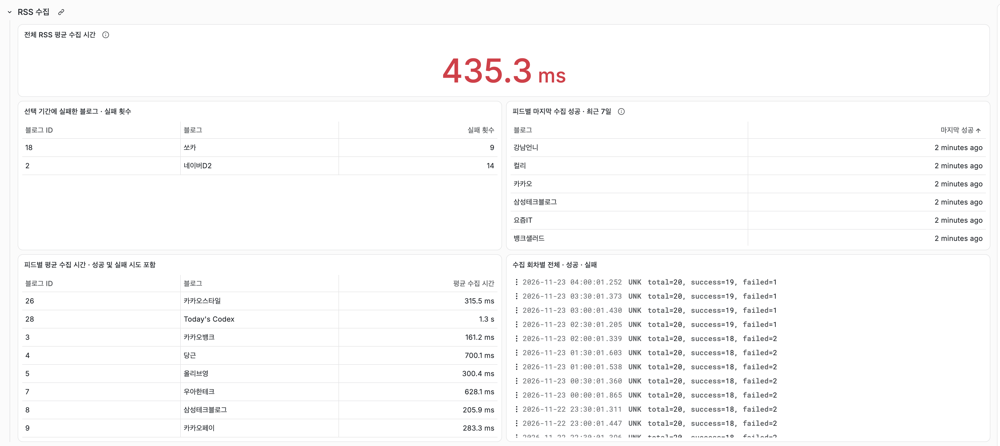
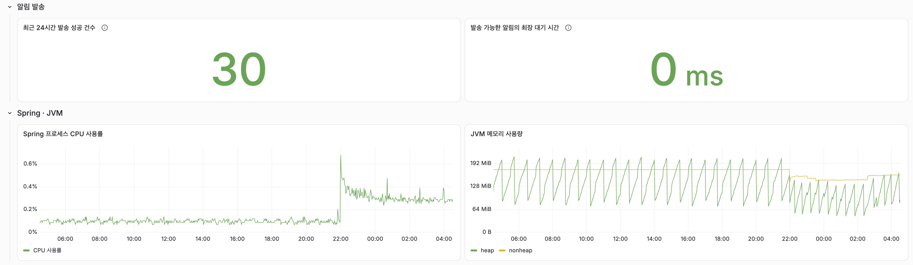

# TechMoa

TechMoa App은 여러 기술 블로그의 RSS를 수집해 아티클을 통합 제공하고, 신규 글 발생 시 웹훅으로 알림을 전달하는 Kotlin + Spring Boot 기반 멀티모듈 백엔드 애플리케이션입니다.

## 핵심 기능

- 여러 기술 블로그 RSS를 가상 스레드로 동시에 수집하고 중복 없이 아티클을 저장합니다.
- 현재까지 약 1,000개의 블로그 아티클을 볼 수 있습니다.
- 카카오 OAuth로 회원가입·로그인할 수 있습니다.
- 웹훅(Discord)을 등록하면 이후 수집된 새 글을 MySQL Outbox를 거쳐 직접 발송합니다. 개별·전역 429 제한이 풀리면 발송을 재개합니다.
- Loki + Grafana로 RSS 수집 결과와 알림 발송 성공 건수를 모니터링합니다.

## 알림 예시

새 글이 등록되면 아래처럼 Discord 채널로 알림이 전달됩니다.

## 멀티모듈 구조

## 모니터링

RSS 수집 시간·실패 블로그·최근 24시간 발송 성공 건수를 Grafana 대시보드로 확인합니다. 설치 절차와 패널 해석은 [ops/rss-monitoring](ops/rss-monitoring/README.md)에 있습니다.

